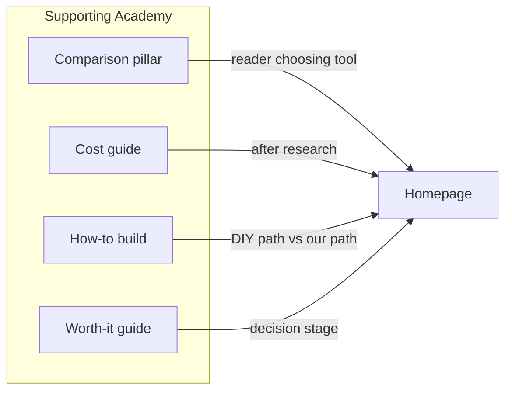
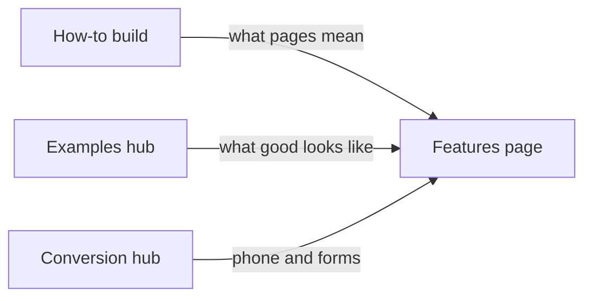

# Page and linking map — Phase 1B

**Purpose:** Show which URL owns each principal search intent, supporting clusters, contextual internal links, cannibalisation risks, and pages to **combine**.

**Not** a final Academy table of contents.

---

## 1. Existing commercial pages

| URL | Owns (principal intent) | Primary keywords (ranked) | Do not target here |
|-----|-------------------------|---------------------------|---------------------|
| [Homepage `/`](https://plumberswebsites.com/) | Plumber website builder; website for plumbers; DFY obtain-site | Ranks 1–3, 6–7, 11, 13–19 | “Best builder” comparisons (Academy) |
| [Features `/features/`](https://plumberswebsites.com/features/) | Design, included features, five pages, mobile | Ranks 5, 23–24, 25+ structure/features | **plumber website builder** as H1 |
| [`/#business`](https://plumberswebsites.com/#business) | Design/template choice | Template cluster (rank 9) | Long-form template SEO article |
| [`/#pricing`](https://plumberswebsites.com/#pricing) | Buyer pricing / packages | Cost-related Tier 1 (rank 4, 17–19) | Deep TCO essay (Academy) |
| [`/#design`](https://plumberswebsites.com/#design) | Preview-before-pay process | Preview cluster (ranks 8, 10) | — |
| [`/#faq`](https://plumberswebsites.com/#faq) | Free vs preview; capabilities | Free/trial phrasing (13–15) | — |
| [Proton example](https://protonplumbing.plumberswebsites.com/) | Social proof | examples / demo queries | — |

---

## 2. Proposed high-priority Academy / commercial pages

| Proposed URL | Tier | Owns | Rank (primary kw) |
|--------------|------|------|-------------------|
| `/academy/best-plumber-website-builder/` | 2 | Best builder / tool selection | 20 |
| `/academy/plumbing-website-cost/` | 1–2 | Cost research / TCO | (supports rank 4) |
| `/academy/how-to-build-a-plumbing-website/` | 2 | How-to flagship | 22 |
| `/academy/plumbing-website-checklist/` | 2 | Launch checklist | ~30s in CSV |
| `/academy/plumbing-website-examples/` | 1–2 | Examples / inspiration | 12 supporting |
| `/academy/ai-plumbing-website-builder/` | 2 | AI builder comparison | 21 |
| `/academy/plumber-website-builder-vs-wix/` | 2 | Wix spoke | tier 2 band |
| `/academy/wordpress-for-plumbing-business/` | 2 | WordPress path | tier 2 band |
| `/academy/plumbing-website-conversion/` | 2 | CTAs, phone, forms | tier 2 band |
| `/academy/plumbing-website-hosting-and-domain/` | 2 | Hosting/domain (verified only) | tier 2 band |
| `/academy/google-business-profile-plumbers/` | 3 | GBP for owners | 106+ |
| `/academy/local-seo-plumbing-company/` | 3 | Local SEO pillar | 113+ |
| `/academy/seo-for-plumbing-business/` | 3 | Owner SEO pillar | 104+ |
| `/academy/get-more-plumbing-customers/` | 3 | Leads/customers | 108+ |

**Combine rather than publish separately (initially):**

- `vs squarespace`, `vs godaddy`, `yola`, `duda`, `weebly` → **sections** under comparison pillar or one “DIY platforms” spoke.  
- `click to call`, `quote form`, `conversion rate` → **one conversion hub** unless SERP shows unique URLs.  
- `schema markup`, `meta title`, `service page seo` → **sections** under SEO pillar.  
- `plumbing website maintenance`, `privacy policy`, `terms` → **one maintenance/legal basics** guide.

---

## 3. Supporting-content clusters (by commercial page)

### Homepage

### Features

### Comparison pillar

Supports: cost guide, AI builders spoke, WordPress spoke, CRM vs site (later).  
Links **to** homepage (start preview) and Features (what’s included) **once**, contextually.

---

## 4. Contextual internal linking (rules)

| From | To | When / anchor style |
|------|-----|---------------------|
| Comparison pillar | Homepage | After criteria table — “preview your own five-page site” |
| Comparison pillar | Features | When discussing pages included |
| Cost guide | `#pricing` | “Current PlumbersWebsites pricing” |
| How-to build | Features + app | Step “choose structure” / “start preview” |
| GBP / local SEO | Homepage | “Website URL on GBP should match your owned site” |
| Any Academy | Homepage | Max one product mention in conclusion unless article is comparison |

**Avoid:** Footer-like repeated CTAs on every paragraph; exact-match “plumber website builder” links from Academy titles; Features → homepage with head term in every H2.

---

## 5. Cannibalisation risks

| Risk | Mitigation |
|------|------------|
| Features targets “plumber website builder” | Keep Features H1 as **inclusions/design**; no title/H1 change to head term |
| Academy how-to steals homepage | How-to = informational H1; CTA only; homepage keeps transactional H1 |
| Cost guide vs `#pricing` | Guide = research; pricing section = buy; cross-link both ways |
| Multiple comparison URLs | One pillar live first; spokes canonical to pillar where content overlaps |
| Tier 3 “plumber seo” vs homeowner SEO industry | Owner framing; exclude “rank for emergency plumber” tactics |

---

## 6. Intent ownership quick reference

| Cannibal group | Single owner |
|----------------|--------------|
| CG-01 | Homepage |
| CG-02 | Features |
| CG-03 | `#business` + examples Academy |
| CG-04 | `#pricing` + cost Academy |
| CG-05 | `#design` + FAQ |
| CG-06 | Comparison pillar (+ spokes) |
| CG-08 | How-to + checklist (linked) |
| CG-15 | SEO pillar (+ on-page sections) |

---

## 7. Pages justified vs not (from ranked top 130)

- **26 unique URLs** appear in `ranked-keyword-opportunities.csv`.  
- **130 keywords ≠ 130 pages** — **109** ranked rows are `supporting_variation`.  
- Expanding to **~55–72** pages is justified when deferred pillars/spokes pass SERP review; **not** by splitting supporting variations.
