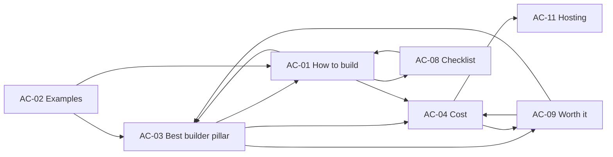

# Phase 1E — Internal linking plan

**Scope:** Existing commercial URLs + initial Academy articles (Phase 1E map).  
**Academy hub URLs:** Placeholder `/academy.html` (empty) — future category hubs link when built.  
**Evidence:** Phase 1C–1D; Ahrefs bands **2026-10-18** (not exact volumes).

---

## Principles

1. **One primary keyword owner per URL** — Academy educates; commercial pages convert.  
2. **Descriptive anchors** — exact match only when natural (e.g. “plumbing website cost” → cost article or `#pricing`).  
3. **Maximum one strong product CTA block per Academy article** (conclusion or next-step), plus contextual inline links.  
4. **No footer-style keyword lists** inside article bodies.

---

## Commercial pages → Academy (outbound)

| Commercial URL | Link to Academy | Anchor (example) | Why |
|----------------|-----------------|------------------|-----|
| `/` (homepage) | AC-03 | Compare plumber website builders | Consideration-stage readers |
| `/` | AC-01 | How to build a plumbing website | Research before sign-in |
| `/features/` | AC-01 | Step-by-step guide for owners | Depth beyond product page |
| `/features/` | AC-05 (section) | What pages a plumbing site needs | Same intent, Features owns structure |
| `/#business` | AC-02 | Plumbing website examples | Inspiration after gallery |
| `/#pricing` | AC-04 | How much a plumbing website costs | TCO beyond list price |
| `/#design` | AC-01 | Build process overview | Process context |
| `/#faq` | AC-04, AC-11 | Cost guide / hosting guide | FAQ depth |

---

## Academy → Commercial (inbound support)

| Article | Primary commercial target | Secondary | Anchor examples |
|---------|---------------------------|-----------|-----------------|
| AC-01 How to build | `/` + `/#design` | `/features/` | “start your preview”, “see how it works”, “what’s included” |
| AC-02 Examples | `/#business` | Proton subdomain | “choose a design”, “see a live example” |
| AC-03 Best builder | `/` | `/features/` | “preview your own site”, “what’s included in your site” — **not** “plumber website builder” as spammy repeat |
| AC-04 Cost | `/#pricing` | `/` | “see our pricing”, “start with a preview” |
| AC-08 Checklist | `/features/`, `/#design` | `/` | “use our five-page structure”, “begin the preview” |
| AC-09 Worth it | `/` | `/#pricing` | “get a professional site built for you”, “see pricing” |
| AC-11 Hosting | `/#faq` | `/features/` | “questions about your site”, “what’s included” |

**Sections only (inside AC-03):** AC-06 Wix, AC-07 AI, AC-10 WordPress — each links once to `/` with “trade-focused preview” angle, not duplicate comparison URLs.

---

## Academy ↔ Academy (contextual)

| From | To | Anchor | Reason |
|------|-----|--------|--------|
| AC-03 | AC-04 | Plumbing website costs | Comparisons lead to budget |
| AC-03 | AC-01 | How to build a plumbing website | Implementation path |
| AC-01 | AC-03 | Best plumber website builder | Tool choice |
| AC-01 | AC-04 | Cost ranges | After steps, budget |
| AC-02 | AC-03 | Compare builders | After inspiration, choice |
| AC-04 | AC-09 | Is a website worth it | ROI framing |
| AC-08 | AC-01 | Full build guide | Checklist → depth |

---

## Cannibalisation guards

| Risk | Mitigation |
|------|------------|
| AC-03 vs homepage for **plumber website builder** | AC-03 H1: “Best Plumber Website Builder **(Comparison)**”; homepage keeps H1 **PLUMBER WEBSITE BUILDER** |
| AC-04 vs `#pricing` for **plumbing website cost** | AC-04 = TCO/DIY/agency; `#pricing` = your offer + price |
| AC-02 vs `#business` for **examples/templates** | `#business` = pick a design; AC-02 = criteria, screenshots, Proton story |
| AC-05 vs Features for **page structure** | No standalone AC-05 URL; expand `/features/` |
| Wix/AI/WordPress spokes vs AC-03 | Single pillar with H2s until Semrush proves separate URLs |

---

## Future category hubs (six-category ~300 plan)

When hubs exist, each standalone Academy article gets **one** breadcrumb/hub link:

| Category slug (proposed) | Initial articles |
|--------------------------|------------------|
| `/academy/build/` | AC-01, AC-08, AC-05-section |
| `/academy/choose-builder/` | AC-03 (+ sections 06/07/10) |
| `/academy/cost-roi/` | AC-04, AC-09 |
| `/academy/design-examples/` | AC-02 |
| `/academy/features-maintenance/` | AC-11 |
| `/academy/visibility/` | *(Wave 3 — GBP, local SEO; not in initial set)* |

---

## Implementation order for links

1. Publish **AC-03**, **AC-04**, **AC-01** (triangle supports homepage + pricing + features).  
2. Add homepage/footer **one** text link to Academy index when `/academy/` exists.  
3. Add **AC-02**, **AC-09**, **AC-08**, **AC-11** with cross-links as above.  
4. Update **Features** and **#pricing** with single contextual links to AC-04 / AC-01 when articles are live (implementation phase — not now).
